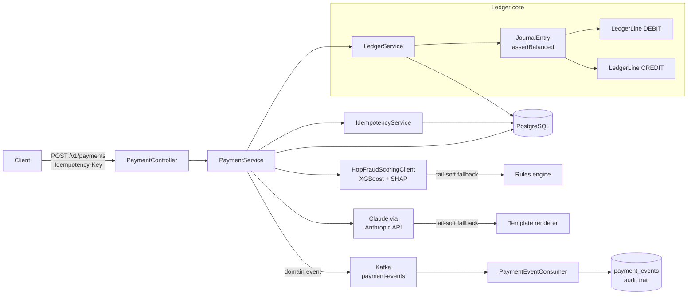

# LedgerFlow

[](https://dl.circleci.com/status-badge/redirect/gh/taniyanandi/ledgerflow/tree/main)
[](https://openjdk.org/projects/jdk/21/)
[](https://spring.io/projects/spring-boot)
[](https://www.postgresql.org/)
[](https://kafka.apache.org/)
[](LICENSE)
[](https://hacktoberfest.com)
[](https://github.com/taniyanandi/ledgerflow/issues?q=is%3Aissue+is%3Aopen+label%3A%22good+first+issue%22)

A payment orchestration platform, built the way real payment systems are built: **correct under retries, exact with money, provably balanced, and consistent when things go wrong.**

> The goal of this project is not to clone a checkout button. It is to demonstrate the machinery underneath a payment gateway — the parts that are hard to get right and that payment teams actually screen for: **idempotency, double-entry correctness, exact money arithmetic, safe state transitions, and real integration testing.**

---

## 🎯 What makes this different

Most payment tutorials store a balance column and call it a day. LedgerFlow makes three deliberate correctness choices:

1. **Money is never a floating-point number.** All amounts are integer *minor units* (paise/cents) stored as `BIGINT`/`long`. `0.1 + 0.2 != 0.3` has no place in a ledger.
2. **Balances are derived, never stored.** An account's balance is always computed by summing its ledger lines — correct by construction, impossible to drift.
3. **Every write is idempotent.** Networks retry. The same `Idempotency-Key` always returns the same result, enforced by a PostgreSQL unique constraint — not application memory.

---

## Architecture



---

## Tech stack

| Layer | Technology |
|---|---|
| Runtime | Java 21, Spring Boot 3.3.4 |
| Database | PostgreSQL 16 + Flyway migrations |
| Messaging | Apache Kafka |
| ML | XGBoost + SHAP (Python `fraud-service/`) |
| LLM | Claude (Anthropic API) + Spring AI |
| Testing | JUnit 5 + Testcontainers (real Postgres in CI) |
| CI | CircleCI (machine executor) |
| Docs | springdoc / Swagger UI |

---

## What's built (phases)

- ✅ **Phase 1 — Financial core.** Idempotent payment API + double-entry ledger
- ✅ **Phase 2 — Orchestration.** Explicit state machine + saga with compensating transactions + Kafka event backbone with persisted audit trail
- ✅ **Phase 3 — Webhooks + reconciliation.** Signed outbound webhook events with retries; reconciliation engine matching the ledger against settlement files
- ✅ **Phase 4 — AI fraud scoring.** XGBoost model with SHAP explanations — every decline says *why*. Fail-soft rules fallback
- ✅ **Phase 6 — LLM risk analyst.** Claude turns SHAP reasons into plain-English narratives; ops assistant answers questions about specific payments. Fail-soft template fallback

---

## Quickstart

```bash
# Clone and start
git clone https://github.com/taniyanandi/ledgerflow.git
cd ledgerflow/ledgerflow
docker compose up --build

# Create a payment (idempotent)
curl -s -X POST http://localhost:8080/v1/payments \
  -H "Content-Type: application/json" \
  -H "Idempotency-Key: demo-001" \
  -d '{"merchantReference":"order-42","amountMinor":150000,"currency":"INR"}' | jq

# Retry the SAME request — same key → same payment, charged once
curl -s -X POST http://localhost:8080/v1/payments \
  -H "Content-Type: application/json" \
  -H "Idempotency-Key: demo-001" \
  -d '{"merchantReference":"order-42","amountMinor":150000,"currency":"INR"}' | jq

# See the ledger is balanced (both return 150000)
curl -s http://localhost:8080/v1/accounts/ACQUIRER_CASH/balance | jq
curl -s http://localhost:8080/v1/accounts/MERCHANT_PAYABLE/balance | jq

# Run the full orchestrated saga (authorize → ML risk check → capture)
curl -s -X POST http://localhost:8080/v1/orchestrated-payments \
  -H "Content-Type: application/json" \
  -d '{"merchantReference":"ord-9","amountMinor":250000,"currency":"INR",
       "risk":{"amountZscore":0.2,"txnVelocity1h":1,"geoDistanceKm":6,
               "deviceNew":0,"hourOfDay":13,"isForeign":0,"cardAgeDays":700}}' | jq
```

- **Swagger UI:** `http://localhost:8080/swagger-ui.html`
- **Health / metrics:** `http://localhost:8080/actuator/health`
- **Fraud service docs:** `http://localhost:8000/docs`

Run tests (requires Docker for Testcontainers):

```bash
cd ledgerflow
mvn test
```

---

## API reference

| Method | Path | Notes |
|---|---|---|
| `POST` | `/v1/payments` | Create + capture. **Requires `Idempotency-Key` header.** |
| `GET` | `/v1/payments/{id}` | Fetch a payment |
| `POST` | `/v1/payments/{id}/refund` | Refund (posts the reverse journal entry) |
| `GET` | `/v1/accounts/{code}/balance` | Live, derived account balance |
| `POST` | `/v1/orchestrated-payments` | Full saga: authorize → ML risk check → capture |
| `GET` | `/v1/orchestrated-payments/{id}/events` | Persisted Kafka event audit trail |
| `GET` | `/v1/orchestrated-payments/{id}/risk-explanation` | LLM narrative over SHAP risk reasons |
| `POST` | `/v1/ops-assistant/ask` | Ask about a payment; Claude answers from retrieved facts |
| `POST` | `/v1/webhooks` | Register a webhook endpoint |
| `POST` | `/v1/reconciliation/run` | Run settlement file reconciliation |

---

## Contributing — Hacktoberfest 2026 🎃

We have [good first issues](https://github.com/taniyanandi/ledgerflow/issues?q=is%3Aissue+is%3Aopen+label%3A%22good+first+issue%22) open — each is scoped, has clear acceptance criteria, and points to the exact files to change:

| Issue | Stack | Difficulty |
|---|---|---|
| Add `GET /accounts` endpoint — list all ledger accounts | Java, Spring Boot | 🟢 Beginner |
| Add `GET /payments/{id}/events` — expose Kafka audit trail | Java, REST API | 🟢 Beginner |
| Add `GET /risk-decisions/{paymentId}` — expose ML fraud scores | Java, AI/ML | 🟢 Beginner |
| Fix missing FK on `payment_events.payment_id` | PostgreSQL, Flyway | 🟢 Beginner |
| Add connect/read timeouts to fraud scoring HTTP client | Java, resilience | 🟢 Beginner |
| Add request validation to `OrchestratedPaymentRequest` | Java, Spring Boot | 🟢 Beginner |
| Add pagination to `GET /v1/payments` | Java, Spring Data | 🟢 Beginner |
| Add Kafka health check to `/actuator/health` | Java, Spring Actuator | 🟢 Beginner |
| Add Swagger/OpenAPI annotations to all controllers | Java, Documentation | 🟢 Beginner |
| Add webhook delivery dashboard endpoint | Java, REST API | 🟢 Beginner |
| Validate currency against ISO 4217 codes | Java, Validation | 🟢 Beginner |
| Create a Postman / Bruno API collection | Documentation | 🟢 Beginner |
| Add Docker health checks to docker-compose | Docker | 🟢 Beginner |
| Add structured logging with correlation IDs | Java, SLF4J | 🟡 Intermediate |
| Add rate limiting to the payment API | Java, Concurrency | 🟡 Intermediate |
| Make webhook retry/backoff configurable | Java, Spring Boot | 🟡 Intermediate |

**First time contributing to open source?** Look for issues marked 🟢 Beginner — they include step-by-step instructions and point to example code already in the project. Comment on the issue to claim it before starting.

See [CONTRIBUTING.md](CONTRIBUTING.md) to get started.

---

## Repo layout

```
ledgerflow/              ← Spring Boot app (Java 21)
  src/
  fraud-service/         ← Python XGBoost + SHAP fraud scorer
  .circleci/config.yml   ← CI pipeline
CONTRIBUTING.md
```


